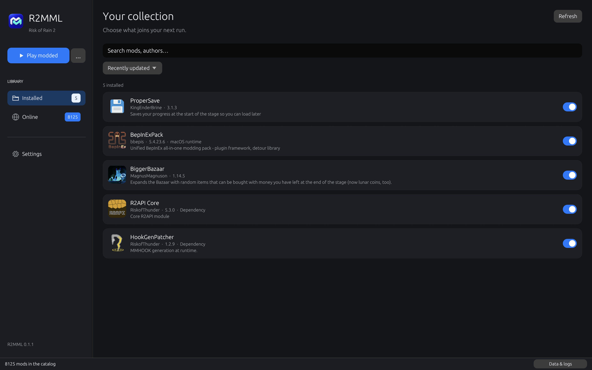

<p align="center">
  
</p>

<h1 align="center">R2MML</h1>

<p align="center">
  <strong>Your Risk2Mac mods, together in one native Mac app.</strong><br>
  Browse Thunderstore. Install dependencies. Play with mods.
</p>

<p align="center">
  <a href="README.ru.md">Русский</a> · <a href="https://github.com/TsiFroviK/R2MML/releases">Download</a>
</p>



**Risk2MacModLoader** — a macOS mod manager for the [Risk2Mac](https://github.com/TsiFroviK/Risk2Mac) port of Risk of Rain 2, written in Rust.

Browse Thunderstore, choose a mod version, install its dependencies, and start the game with or without mods. R2MML keeps mods and their configuration outside the game application. Opening the game normally continues to start vanilla.

This manager is specifically for Risk2Mac. It does not install the game or turn a Windows installation into a Mac port.

## Features

- A macOS-inspired interface with Installed, Online, and Settings views.
- Thunderstore search, sorting, package information, formatted README and changelog, and version selection.
- Package icons cached on disk between launches, and expandable dependency cards with package information.
- Automatic dependency installation, with the selected mod version preserved.
- Enable, disable, and remove installed mods. Required dependencies cannot accidentally be disabled or removed while still needed.
- Separate **Start modded** and **Start vanilla** actions.
- Automatic Russian interface when Russian is the system's primary language; English for other primary languages.
- Apple Silicon and Intel build targets, with native BepInEx for macOS downloaded when needed.
- Cached downloads, an offline catalog fallback, and separate manager/game logs.

The application and its packaging tool are implemented in Rust. The interface uses egui/eframe; there is no bundled browser, JavaScript frontend, or Electron runtime.

## Install

1. Install a working [Risk2Mac game build](https://github.com/TsiFroviK/Risk2Mac). The manager expects its `.app` layout and compatibility components.
2. Download the macOS **DMG** from [Releases](https://github.com/TsiFroviK/R2MML/releases), open it in Finder, and drag **R2MML.app** into **Applications**. Eject the disk image after copying.
3. Open R2MML. If a working game is not found in **Applications** or at your saved location, a small setup window asks you to choose **Risk of Rain 2.app**. The path is remembered; you can change it later in **Settings**.
4. Open **Online**, select a mod, click **Download**, select a version, and install it with dependencies.
5. Use **Start modded**. The first modded launch downloads and verifies the native macOS BepInEx runtime.

The intended minimum system is macOS 11. Use a game build matching the Mac's architecture. The universal manager contains both Apple Silicon and Intel slices. Apple Silicon mod loading has been tested; the Intel target is built but still needs testing on an actual Intel Mac.

The release is locally signed, rather than Apple-notarized. If macOS blocks its first launch, follow Apple's application-specific **Privacy & Security → Open Anyway** instructions for software you trust. [Apple's instructions](https://support.apple.com/en-us/102445)

## Everyday use

**Installed** shows the selected versions and their enabled state. Enabling a mod automatically enables all its installed dependencies, including indirect ones. Unrelated disabled mods stay disabled. Disabling or removing a mod takes effect on the next modded launch. Changes do not alter an already running game. Disabling a required dependency opens a list of affected mods, including indirect dependents. Choose **Disable all** to disable the dependency and those mods together, **Disable only this mod** to keep the others enabled, or **Cancel**. Disabling only the dependency may prevent dependent mods from loading or working. A required mod cannot be uninstalled until its dependents are removed.

**Online** reads the Risk of Rain 2 catalog directly from [Thunderstore](https://thunderstore.io/c/riskofrain2/). A selected mod stays at the version you choose. New dependencies use the latest active version satisfying their minimum requirement; already installed satisfactory versions are retained. Missing or conflicting dependencies produce an error instead of a partially committed mod list.

**Start vanilla** opens the original game without R2MML's mod-loading environment. Starting the game's `.app` directly also remains vanilla. R2MML does not put a loader, proxy DLL, plugin, or patched assembly inside the game bundle.

### macOS compatibility

R2MML uses the official [BepInEx 5.4.23.6 macOS universal release](https://github.com/BepInEx/BepInEx/releases/tag/v5.4.23.6), verified against a pinned SHA-256. This version includes native ARM64 loading fixes. The runtime is fetched from BepInEx's GitHub release, not bundled with the manager.

Thunderstore's **bbepis-BepInExPack** is treated as a runtime requirement provided by this macOS runtime. Its Windows loader files and Windows distribution's additional default packages are not installed. Normal mods' own explicit dependencies are still resolved and installed, including game-specific packages if they name them directly.

Managed `.dll` mods can work on macOS, but compatibility depends on the individual mod and game version. Windows-native DLLs and Windows-only integrations cannot be made compatible merely by downloading them. R2MML rejects native Windows DLLs in the active plugin set. Other platform-specific assumptions may still fail at runtime; check the logs and disable the affected mod.

Native Apple Silicon validation includes loading **ProperSave 3.1.3** and **HookGenPatcher 1.2.9** through the macOS BepInEx runtime. This does not establish compatibility with every Thunderstore package or confirm Intel gameplay.

## Files and logs

R2MML uses this directory in your home folder:

```text
~/Library/Application Support/R2MML/
├── settings.json
├── Cache/                         Downloaded catalog, packages, and runtime
├── Logs/R2MML.log                Manager activity and errors
└── Profiles/Default/
    ├── profile.json              Installed versions and enabled state
    ├── packages/                 Stored package contents
    ├── BepInEx/
    │   ├── core/                 Native-Mac-compatible managed runtime
    │   ├── plugins/              Enabled plugins for the next launch
    │   ├── patchers/
    │   ├── config/               Mod settings, preserved across updates
    │   └── LogOutput.log         BepInEx and mod diagnostics
    └── logs/                     Modded launch and Unity logs
```

The initial release uses one **Default** mod profile. Game saves remain managed by the game and its selected Steam/local mode. Mods may have their own save behavior.

When reporting a problem, include the manager version, Mac architecture, selected mod versions, and the relevant log from these directories. Review logs before posting them publicly because they can contain local paths or account identifiers.

## Build from source

Build on macOS with Rust 1.88 or newer and Apple's Xcode Command Line Tools. A Rust toolchain can be installed with [rustup](https://rustup.rs/).

```bash
git clone https://github.com/TsiFroviK/R2MML.git
cd R2MML
cargo test --locked
cargo run --locked --bin r2mml
```

Build the application for the current architecture:

```bash
cargo run --locked --bin package
```

Build a universal application containing ARM64 and x86_64:

```bash
rustup target add aarch64-apple-darwin x86_64-apple-darwin
cargo run --locked --bin package -- --universal
```

The Rust packaging tool builds the binaries, creates the `.app` and icon, signs the application locally, and creates a **DMG** installer in `dist/`. No proprietary game data, Unity runtime, Steam binary, or downloaded mod is needed to compile R2MML.

## License and attribution

R2MML's original code and artwork are available under the [MIT license](LICENSE). Third-party libraries retain their own licenses. BepInEx and downloaded mods are separate projects and remain subject to their own licenses; they are downloaded from their upstream distribution endpoints when requested.

This project is not affiliated with Gearbox, Hopoo Games, Valve, or Thunderstore. Risk of Rain 2 and related game assets are not included. Package icons and descriptions shown in the catalog are retrieved from Thunderstore at runtime.

Created by TsiFroviK with contributions from Codex.
