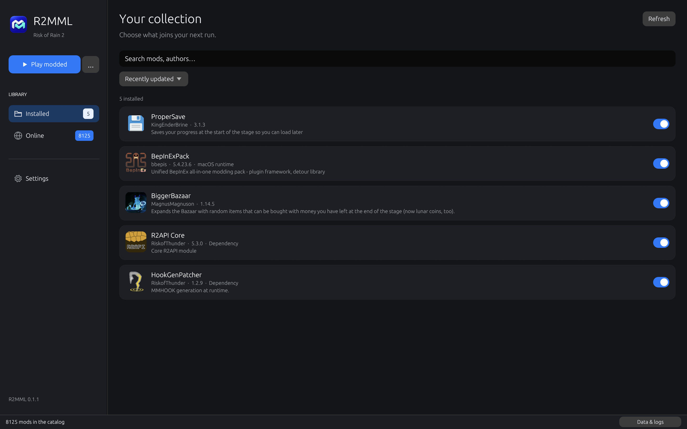

<p align="center">
  
</p>

<h1 align="center">R2MML</h1>

<p align="center">
  <strong>Ваши моды для Risk2Mac — в одном приложении для Mac.</strong><br>
  Выбирайте моды в Thunderstore. Устанавливайте зависимости. Играйте с модами.
</p>

<p align="center">
  <a href="README.md">English</a> · <a href="https://github.com/TsiFroviK/R2MML/releases">Скачать</a>
</p>



**Risk2MacModLoader** — менеджер модов для macOS-порта Risk of Rain 2 [Risk2Mac](https://github.com/TsiFroviK/Risk2Mac), написанный на Rust.

Просматривайте Thunderstore, выбирайте версию мода, устанавливайте зависимости и запускайте игру с модами или без них. R2MML хранит моды и их настройки отдельно от игрового приложения. Обычный запуск игры остаётся ванильным.

Менеджер предназначен именно для Risk2Mac. Он не устанавливает игру и не превращает Windows-сборку в порт для Mac.

## Возможности

- Интерфейс в стиле macOS с разделами «Установлено», «Каталог» и «Настройки».
- Поиск и сортировка Thunderstore, информация о пакете, форматированные README и история изменений, выбор версии.
- Кэширование значков модов на диске между запусками и раскрывающиеся карточки зависимостей с информацией о пакетах.
- Автоматическая установка зависимостей с сохранением выбранной версии основного мода.
- Включение, отключение и удаление установленных модов. Нельзя случайно отключить или удалить библиотеку, которая ещё требуется другим модам.
- Отдельные действия **«Запуск с модами»** и **«Без модов»**.
- Русский интерфейс, если русский — основной язык системы; английский для остальных языков.
- Сборки для Apple Silicon и Intel с загрузкой нативного BepInEx для macOS при необходимости.
- Кэш загрузок, доступ к сохранённому каталогу без сети и отдельные журналы менеджера и игры.

Приложение и инструмент его упаковки написаны на Rust. Интерфейс использует egui/eframe; встроенного браузера, JavaScript-интерфейса и Electron нет.

## Установка

1. Подготовьте рабочую [сборку Risk2Mac](https://github.com/TsiFroviK/Risk2Mac). Менеджер ожидает её структуру `.app` и компоненты совместимости.
2. Скачайте **DMG** для macOS в разделе [Releases](https://github.com/TsiFroviK/R2MML/releases), откройте его через Finder и перетащите **R2MML.app** в **«Программы»**. После копирования извлеките образ диска.
3. Откройте R2MML. Если рабочая игра не найдена в **«Программах»** или по сохранённому пути, небольшое стартовое окно предложит выбрать **Risk of Rain 2.app**. Путь сохранится; позже его можно изменить в **«Настройках»**.
4. Откройте **«Каталог»**, выберите мод, нажмите **«Скачать»**, укажите версию и установите её вместе с зависимостями.
5. Нажмите **«Запуск с модами»**. При первом таком запуске менеджер скачает и проверит нативный BepInEx для macOS.

Предполагаемый минимум — macOS 11. Сборка игры должна соответствовать архитектуре Mac. Универсальное приложение менеджера содержит варианты Apple Silicon и Intel. Загрузка модов проверена на Apple Silicon; сборка Intel подготовлена, но ещё требует проверки на настоящем Intel Mac.

Релиз имеет локальную подпись и не прошёл нотариальную проверку Apple. Если macOS блокирует первый запуск, используйте предусмотренное Apple действие **«Конфиденциальность и безопасность → Всё равно открыть»** для приложения, которому доверяете. [Инструкция Apple](https://support.apple.com/en-us/102445)

## Использование

В разделе **«Установлено»** отображаются выбранные версии и состояние модов. При включении мода автоматически включаются все его установленные зависимости, включая косвенные. Остальные отключённые моды не меняются. Отключение и удаление применяются при следующем запуске с модами. Уже запущенная игра не изменяется. При отключении нужной зависимости открывается список затронутых модов, включая косвенно зависящие от неё. Выберите **«Отключить все»**, чтобы отключить зависимость вместе с ними, **«Отключить только этот мод»**, чтобы оставить остальные включёнными, или **«Отмена»**. При отключении только зависимости использующие её моды могут не загрузиться или работать с ошибками. Для удаления нужной библиотеки сначала удалите зависящие от неё моды.

Раздел **«Онлайн»** получает каталог Risk of Rain 2 непосредственно из [Thunderstore](https://thunderstore.io/c/riskofrain2/). Основной мод устанавливается в выбранной вами версии. Для новых зависимостей выбирается последняя активная версия, удовлетворяющая минимальному требованию; уже установленные подходящие версии сохраняются. Недостающие или конфликтующие зависимости вызывают ошибку, а список установленных модов не сохраняется частично.

Действие **«Без модов»** открывает оригинальное приложение без подключения загрузчика R2MML. Прямой запуск игрового `.app` также остаётся ванильным. R2MML не помещает в приложение игры загрузчик, прокси-DLL, плагины или изменённые игровые сборки.

### Совместимость с macOS

R2MML использует официальный [BepInEx 5.4.23.6 macOS universal](https://github.com/BepInEx/BepInEx/releases/tag/v5.4.23.6) с проверкой закреплённой контрольной суммы SHA-256. В этом выпуске есть исправления нативной загрузки ARM64. Среда загружается из релиза BepInEx на GitHub, а не включается в менеджер.

Пакет Thunderstore **bbepis-BepInExPack** считается требованием к среде загрузки, которое выполняет этот macOS-вариант BepInEx. Windows-загрузчик и дополнительные пакеты, добавленные в его Windows-дистрибутив, не устанавливаются. Прямые зависимости обычных модов продолжают разрешаться и устанавливаться, включая игровые пакеты, явно указанные конкретным модом.

Управляемые `.dll`-моды могут работать на macOS, но совместимость зависит от самого мода и версии игры. Нативные Windows-DLL и привязанные к Windows интеграции нельзя адаптировать простой загрузкой. R2MML отклоняет нативные Windows-DLL в активном наборе плагинов. Другие особенности мода могут проявиться уже при запуске: проверяйте журнал и отключайте проблемный мод.

На Apple Silicon проверена нативная загрузка **ProperSave 3.1.3** и **HookGenPatcher 1.2.9** через macOS-вариант BepInEx. Это не означает совместимость со всеми пакетами Thunderstore и не подтверждает игровой процесс на Intel.

## Файлы и журналы

Менеджер использует следующую папку в домашнем каталоге:

```text
~/Library/Application Support/R2MML/
├── settings.json
├── Cache/                         Каталог, архивы модов и среда загрузки
├── Logs/R2MML.log                Действия и ошибки менеджера
└── Profiles/Default/
    ├── profile.json              Установленные версии и их состояние
    ├── packages/                 Сохранённое содержимое пакетов
    ├── BepInEx/
    │   ├── core/                 Управляемая среда для нативного Mac
    │   ├── plugins/              Плагины для следующего запуска
    │   ├── patchers/
    │   ├── config/               Настройки модов, сохраняемые при обновлении
    │   └── LogOutput.log         Диагностика BepInEx и модов
    └── logs/                     Журналы запуска с модами и Unity
```

Первый выпуск использует один профиль модов **Default**. Сохранениями игры по-прежнему управляет сама игра в выбранном режиме Steam или локальном режиме. Отдельные моды могут иметь собственную логику сохранения.

При сообщении об ошибке укажите версию менеджера, архитектуру Mac, версии выбранных модов и приложите соответствующий журнал. Перед публичной публикацией просмотрите журналы: они могут содержать локальные пути и идентификаторы аккаунтов.

## Сборка из исходников

Для сборки на macOS нужны Rust 1.88 или новее и Xcode Command Line Tools от Apple. Rust можно установить через [rustup](https://rustup.rs/).

```bash
git clone https://github.com/TsiFroviK/R2MML.git
cd R2MML
cargo test --locked
cargo run --locked --bin r2mml
```

Сборка приложения для текущей архитектуры:

```bash
cargo run --locked --bin package
```

Универсальное приложение с ARM64 и x86_64:

```bash
rustup target add aarch64-apple-darwin x86_64-apple-darwin
cargo run --locked --bin package -- --universal
```

Инструмент упаковки на Rust собирает исполняемые файлы, создаёт `.app` и иконку, ставит локальную подпись приложения и создаёт установочный образ **DMG** в `dist/`. Для компиляции R2MML не нужны игровые данные, Unity, библиотеки Steam или скачанные моды.

## Лицензия и авторство

Оригинальный код и графика R2MML доступны по [лицензии MIT](LICENSE). Сторонние библиотеки сохраняют собственные лицензии. BepInEx и моды — отдельные проекты со своими условиями: они загружаются из источников их распространения по запросу.

Проект не связан с Gearbox, Hopoo Games, Valve или Thunderstore. Risk of Rain 2 и игровые ресурсы не включены. Значки и описания пакетов в каталоге получаются из Thunderstore во время работы.

Создано TsiFroviK при участии Codex.
